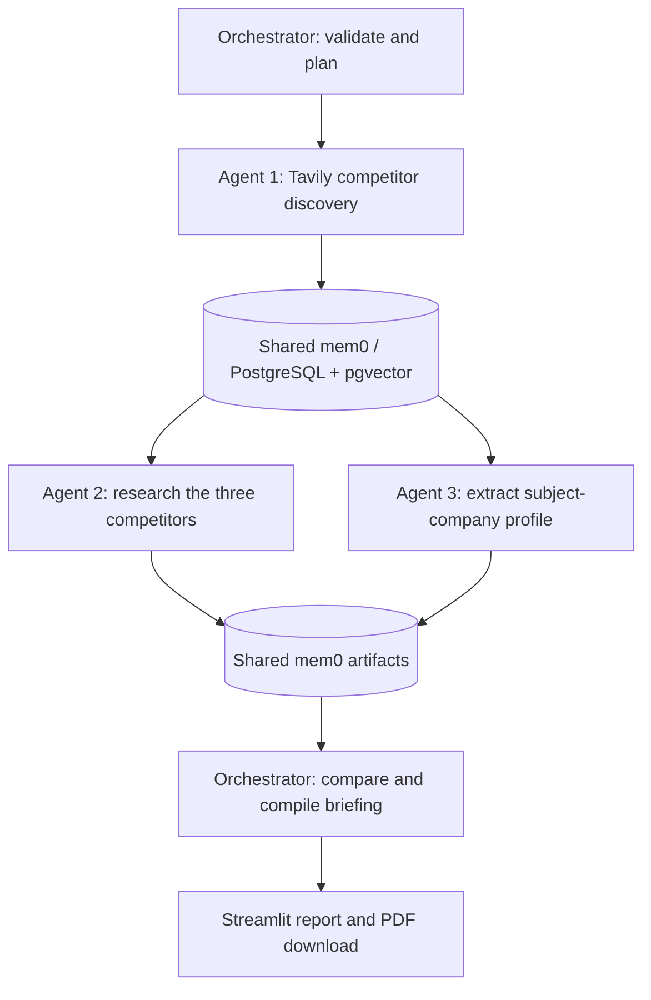

# Competitive Signal

A Streamlit market-research application with three specialist agents, an
orchestrator, Tavily as the primary search source, and real shared mem0 memory.
All application code and tests are in this folder. The repository root provides
the Python environment, dependency lockfile, and `.env`.

## Start

From the repository root:

```bash
uv sync
# Add TAVILY_API_KEY and the project3 settings from project3/.env.example to .env.
docker compose --env-file .env -f project3/compose.yaml -p project3-research up -d --wait
./project3/start-streamlit.sh
```

The startup script reads root `.env` and serves the app at
`http://127.0.0.1:5555`. It works from any working directory and uses the repository
`.venv` interpreter. `P3_STREAMLIT_PORT=5555` and
`P3_STREAMLIT_ADDRESS=127.0.0.1` configure the listener; explicit server arguments
take precedence over other Streamlit port settings. Stop the server with Ctrl-C.

The local PostgreSQL/pgvector service binds to `127.0.0.1:5434`. Its database,
user, password and port are configured in `.env`; existing root credentials are
preserved. The implementation has added missing project3 settings and a random
local database password. The Tavily key remains blank unless you configure it.
If setting up from scratch, replace the example password and update both
`P3_POSTGRES_PASSWORD` and the URL-encoded password in `P3_DATABASE_URL`.

Use **Offline demo** to review the interface and PDF export without service
credentials. The demo uses fictional companies and an in-process memory double;
it does **not** claim to use Tavily, OpenAI or persistent mem0. Switch to **Live
research**, supply a company name (include a website for ambiguous names), and
select **Build competitor briefing** to run the real pipeline. Downloads include
PDF and the structured JSON research artifact. PDF sharing is a download; the
application does not email or publish findings.

## Agent workflow



- Agent 1 resolves the company/market and selects exactly three distinct direct
  competitors with cited reasons. "Top" means evidence-supported relevance, not
  an invented market-share ranking. If the evidence cannot support three, the
  run stops and asks for a more specific input rather than fabricating names.
- Agent 2 **queries mem0** for Agent 1's saved list, then conducts fresh Tavily
  pricing, product/positioning, and recent-news searches for each competitor.
- Agent 3 reads the resolved subject from mem0 and extracts pricing, core
  features, market positioning and recent news for that company.
- Agents 2 and 3 are parallel LangGraph nodes. They save profiles and evidence
  back to mem0; the orchestrator joins both branches, queries all shared
  artifacts, and generates the structured comparative briefing. Research data
  is not handed directly from Agent 1 to Agent 2 through graph state.

## Configuration

All secrets and operational settings belong in the root `.env`.

| Variable | Purpose |
| --- | --- |
| `TAVILY_API_KEY` | Required live search credential |
| `OPENAI_API_KEY`, `OPENAI_MODEL`, `OPENAI_BASE_URL` | Existing model configuration; endpoint must support Chat Completions structured outputs |
| `OPENAI_EMBEDDING_API_KEY`, `OPENAI_EMBEDDING_MODEL`, `OPENAI_EMBEDDING_BASE_URL` | Existing embedding configuration; key/base can fall back to chat configuration |
| `P3_DATABASE_URL` | PostgreSQL URL used by both mem0 pgvector and the history adapter |
| `P3_POSTGRES_DB`, `P3_POSTGRES_USER`, `P3_POSTGRES_PASSWORD`, `P3_POSTGRES_PORT` | Compose database server configuration |
| `P3_MEMORY_COLLECTION` | Dedicated pgvector collection (`project3_research`) |
| `P3_WORKSPACE` | Workspace namespace within mem0 |
| `P3_EMBEDDING_DIMS` | Actual embedding dimensions, default 1536; changing dimensions requires a new collection |
| `P3_SEARCH_RESULTS` | Maximum results per Tavily query, default 5 |
| `P3_NEWS_DAYS` | News recency window in days, default 30 |
| `P3_TIMEOUT_SECONDS` | Tavily and research-model request timeout |
| `P3_SOURCE_CHARS` | Maximum excerpt characters retained per search result |
| `P3_MAX_OUTPUT_TOKENS` | Bound for each structured research-model response |
| `P3_DEBUG`, `LOG_LEVEL`, `P3_LOG_FILE` | Application debugging, log level and optional file output |
| `P3_PDF_FONT_PATH`, `P3_PDF_BOLD_FONT_PATH` | Optional TTF fonts for additional language coverage |

Unlike the older project2 helper, project3's `.env` loader does not overwrite
explicit process environment overrides. Nothing requires a mem0 cloud API key:
this is the open-source SDK backed by your local PostgreSQL. mem0 telemetry is
disabled before SDK initialization. SDK logs are suppressed because they can
contain source excerpts, configuration or connection details; application logs
record stages, counts, memory activity, validation failures and export events.
They do not record credentials, prompts, full search content or briefing text.

## Persistence and isolation

The `mem0ai==2.2.1` dependency is deliberately pinned. The SDK's pgvector provider
uses PostgreSQL for vectors and metadata, but it hardcodes SQLite for internal
history. `memory.py` supplies a PostgreSQL implementation of that history
interface during construction, under a lock, and immediately restores the SDK
module. This is a narrow version-specific adapter, covered by a test that makes
`sqlite3.connect` fail if called. There is no SQLite or default Qdrant fallback.
The Qdrant package is a transitive mem0 dependency, not the configured backend.
Revalidate the history interface before upgrading mem0.

Agent artifacts are stored with `infer=False` so mem0 cannot rewrite competitor
names, citations or JSON structure. A compact descriptor is embedded; the exact
artifact and source records live in metadata, avoiding oversized embedding inputs.
Retrieval uses exact workspace/company hash, unique run ID, and artifact-kind
filters. Memory persists across application restarts, while new research always
creates a fresh run instead of silently recycling stale competitor data. The UI
retains the current completed briefing in its session; a historical-run browser
is not part of this release. Concurrent memory operations are serialized within
a run, while independent Tavily/model research can proceed in parallel.

The Compose volume `project3-research_research-memory` persists data. Use:

```bash
docker compose --env-file .env -f project3/compose.yaml -p project3-research stop
```

Stopping preserves memory. Do not use `down -v` unless you intend to delete it.
Back up PostgreSQL with standard database backup procedures before upgrades.

## Evidence and failure behavior

A normal successful live run makes **13 Tavily searches**: one discovery query
and three per researched company (subject plus three competitors). Searches use
advanced depth and at most three attempts; model requests allow two SDK retries.
Charges depend on provider plans. No live research occurs until the user submits
the form. Embedding calls also consume the configured provider's quota.

News searches use Tavily's news topic and the configured recency window. Results
must carry a parseable ISO or RFC publication date within that window; missing
or stale dates are omitted. Retrieval time is never substituted for publication
time. General web content is freshly retrieved but may itself be old; source
publication dates and provenance remain visible. "No usable evidence" does not
mean "no news exists". Official pricing is requested and preferred, but search
results are not proof that a vendor currently offers a price. Verify important
commercial decisions at the linked original source.

All claims are typed as fact, inference or unknown. Facts and inferences require
source IDs present in the supplied evidence. Recent-news claims must cite
filtered news sources. Unsupported references are rejected. These are provenance
checks, not automated proof that a source entails every claim; hallucinations
and incomplete search excerpts remain limitations. Source text and company
input are treated as data, never as instructions to the agents.

Individual research failures produce explicit unknown fields and collection
notes. A failed shared-memory handoff stops the pipeline; it never silently
switches to passing data in process. Invalid discovery or orchestrator output
also stops the run. PDF failure preserves the briefing so a user can retry export.
PDF paragraphs escape text, wrap long URLs, and include readable references and
page numbers. Bundled Vera fonts support Latin-script output; configure suitable
Unicode TTF fonts for other writing systems.

## Validation

```bash
uv run python -m unittest discover -s project3/tests -v
P3_TEST_POSTGRES=true uv run python -m unittest project3.tests.test_postgres_memory -v
```

The first command exercises the actual graph with fictional service doubles,
mem0 handoff/filter contracts, typed citations, distinct competitors, missing
searches, retry limits, ISO/RFC news freshness, the Streamlit form, PDF download,
and PDF text/escaping. The opt-in integration test uses the **real mem0 SDK and
PostgreSQL/pgvector** with deterministic fake embeddings and a mocked model. It
checks persistence through a fresh client, run/company isolation, PostgreSQL
history and the absence of SQLite. Cleanup deletes only memory IDs returned by
that test's own writes and its uniquely named message scope; it never drops a
collection. Live Tavily/OpenAI authentication is not exercised by offline tests.

PDF QA uses PyMuPDF to render every sample page when system Poppler is unavailable;
all rendered sample pages must be visually checked after layout changes. The
clearly labeled sample export is under `project3/output/pdf/` (generated, ignored
by Git); temporary page images are under `project3/tmp/pdfs/`.

Primary references:
[Tavily Search](https://docs.tavily.com/documentation/api-reference/endpoint/search),
[mem0 pgvector](https://docs.mem0.ai/components/vectordbs/dbs/pgvector),
[LangGraph graph API](https://docs.langchain.com/oss/python/langgraph/graph-api),
[OpenAI structured outputs](https://developers.openai.com/api/docs/guides/structured-outputs).

Verification on 2026-10-22 (local date): all 13 tests passed with PostgreSQL enabled.
The three-page fictional sample PDF was rendered and visually reviewed. The
PostgreSQL/pgvector container is healthy. Live search/model authentication remains
unverified because `TAVILY_API_KEY` has not been configured; no API credits were
spent. Restart Streamlit after editing `.env`. Optional spaCy model notices from
mem0 do not affect the tested run-scoped retrieval; no NLP extras are required.

## Photo background and appearance

Use the **Dark theme** switch at the top of the sidebar. Switching appearance
keeps the current briefing and PDF and does not repeat research or consume API
credits. The choice is local to the page/user; `?appearance=dark` or
`?appearance=light` preserves it on refresh and can be included in a shared link.
No server-global Streamlit theme configuration is changed.

Root `.env` defaults:

```dotenv
P3_DEFAULT_THEME=light
P3_BACKGROUND_ENABLED=true
P3_BACKGROUND_IMAGE=project3/assets/futuristic-it-background.png
```

Set `P3_DEFAULT_THEME=dark` for new sessions to start dark. The photo is bundled
locally, with separate light/dark overlays and readable content panels. Set
`P3_BACKGROUND_ENABLED=false` for solid backgrounds, or configure a local PNG,
JPEG or WebP up to 8 MB. Missing/invalid assets log a warning and fall back to the
solid theme. Relative image paths are resolved from the repository root.
Artwork provenance and the exact generation prompt are in `assets/README.md`.
The comparison uses a four-row HTML table so it follows both appearance modes.
Custom CSS uses Streamlit component selectors; recheck styling after framework
upgrades. This appearance control is independent of Streamlit's Settings menu.

### Agent conversations and external URLs

Normal logs show agent handoffs, public progress summaries, Tavily search endpoint
attempts, actual OpenAI/embedding HTTP requests and response status codes. Source
URLs returned by Tavily are labeled as evidence links, not direct fetches.
Set `P3_DEBUG=true` in root `.env` to include bounded agent task/context/evidence,
validated model responses, and shared-memory artifact exchanges. These are public
messages and results, not private model chain-of-thought. Existing `P3_LOG_FILE`
selects the output file; logs also go to the startup terminal. Restart the app after
changing logging settings. Debug logs contain research content, so retain them accordingly.
Configured environment credentials are redacted from message payloads; HTTP logs
omit headers, bodies, URL user information, query strings and fragments. SDK raw
logging stays disabled. No extra model requests are made for logging.
